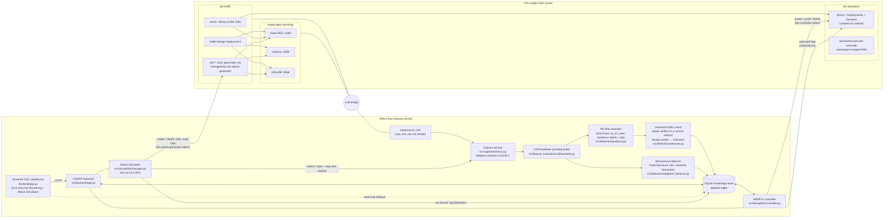
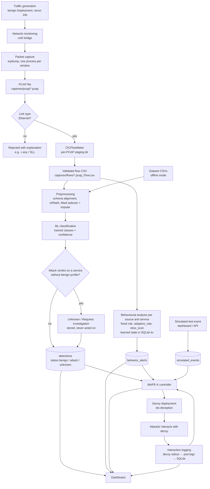

# Architecture

## 1. Component architecture



Isolation and least privilege:

* `ids-traffic` egress is limited by NetworkPolicy to the three target ports, the decoy port and DNS.
* Decoys accept ingress only from `ids-traffic` / `target-apps` and have **no** egress (`egress: []`).
* Decoy pods: non-root UID 65534, read-only root filesystem, all capabilities dropped, no privilege
  escalation, no service-account token, no host namespaces or hostPath, `restricted` Pod Security level.
* The backend uses the `ids-controller` service account: write access only to Deployments/Services in
  `ids-deception`, read-only access to the lab namespaces, nodes and the namespace list. No cluster-admin.

## 2. System workflow



Processing is window-based: a detection appears one window (5–30 s) plus the measured pipeline time
(< 1 s) after the traffic, not packet by packet.

## 3. MAPE-K loop

```mermaid
flowchart LR
    subgraph M["Monitor"]
        m1["new ML detections<br/>(is_malicious only; unknown excluded)"]
        m2["new behavioural alerts<br/>(high: fixed rule, medium: learned)"]
        m3["new simulated events"]
        m4["decoy status (K8s)"]
        m5["decoy interactions (pod logs)"]
    end
    subgraph A["Analyze"]
        a1["group by source + class"]
        a2["confidence ≥ 0.9 → high"]
        a3["≥ 0.6 → medium: needs ≥ 3 detections<br/>in 300 s or a corroborating burst"]
        a4["< 0.6 → low: monitor<br/>benign → never deploy"]
        a5["medium behavioural alert → needs 2 alert<br/>windows or an ML detection"]
        a6["correlate per source into one incident<br/>(ML, behaviour, earlier interactions)"]
    end
    subgraph P["Plan"]
        p1["class / burst port → decoy profiles<br/>(config policy)"]
        p2["order profiles: attacked service,<br/>source's own engagement, engaged sources"]
        p3["deploy · scale · refresh TTL<br/>suppress: limit / cooldown"]
    end
    subgraph E["Execute"]
        e1["create Deployment + Service<br/>from predefined template"]
        e2["scale replicas"]
        e3["remove expired / manual"]
    end
    subgraph K["Knowledge (SQLite)"]
        k1["decisions + reasons + evidence"]
        k2["decoy lifecycle + deploy time"]
        k3["interactions + per-source summaries<br/>(enumerating / repeated / exploring)"]
    end
    M --> A --> P --> E --> K
    K -->|"engagement reorders profiles,<br/>extends TTL, drives density"| P
    K -->|"history for repeat checks"| A
```



Housekeeping (status reconciliation, readiness and deployment time, interaction collection, TTL expiry,
engagement-based scaling) runs every cycle even when automatic deception is disabled. The ML model is
never retrained from decoy interactions.

## 4. Attack Simulator run

Started only by the **START SIMULATION** button on Live Security Monitoring (`POST /api/simulations`).
Every run is a predefined scenario: the request carries a scenario key, an allowed application name and
three bounded numbers, never a URL, command or manifest field.

```mermaid
sequenceDiagram
    participant UI as Dashboard
    participant API as FastAPI
    participant SIM as SimulationManager
    participant CAP as Capture service
    participant K8S as ids-traffic (Job)
    participant DB as SQLite
    UI->>API: POST /api/simulations (scenario, target, duration, rate, max requests)
    API->>SIM: validate scenario + limits, one active run, ConfigMap readable, target pod ready
    SIM->>DB: simulation_runs: requested
    alt capture running
        SIM->>CAP: attach (never stopped by the run)
    else capture stopped
        SIM->>CAP: start (owned by the run)
    end
    SIM->>K8S: create Job sim-… (labels managed-by + run id, ttlSecondsAfterFinished, activeDeadlineSeconds)
    K8S-->>SIM: pod running, pod IP
    K8S-->>SIM: Job complete / failed / deadline, or user cancel
    SIM->>K8S: read generator log → data/simulations/<run>.log.jsonl (before any deletion)
    CAP->>DB: windows: PCAP → CICFlowMeter → ML + behavioural → detections
    SIM->>DB: wait until a processed window covers the last request, then tag generator-pod flows/alerts with sim_run_id
    opt capture owned by the run
        SIM->>CAP: stop (only if the PID is still the run's capture)
    end
    SIM->>K8S: delete Job (foreground) and verify no Job/Pod with the run's labels remains
    SIM->>DB: results + cleanup result; status completed | cancelled | failed | timeout
    UI->>API: GET /api/monitoring/overview every 3 s while a run is active
```

* **Cleanup paths.** Success, failure, cancellation and timeout all end in the same `cleanup()`. The
  Job carries `ttlSecondsAfterFinished` as a Kubernetes-side backstop. At backend start-up (and via
  `POST /api/simulations/recover`), runs left active by an interrupted backend are marked
  `interrupted`, their Jobs and Pods deleted and a capture they owned stopped.
* **Stopping traffic and keeping ground truth.** The generator runs as PID 1 without a SIGTERM handler, so
  simulator Jobs use `terminationGracePeriodSeconds: 1` (a cancel stops traffic within about a second).
  The generator log is snapshotted during the run and, after a stop, read until the pod is gone; the
  generator flushes every line, so the saved log covers every connection that produced a flow.
* **What can be deleted.** Only Jobs/Pods labelled `app.kubernetes.io/managed-by=ids-attack-generator`
  *and* carrying the run's own `ids.lab/sim-run` label; the code checks the labels again before each
  delete. The `ids-attack-generator` identity (kubernetes/simulator/rbac.yaml) can manage Jobs/Pods
  only in `ids-traffic`, read only the generator ConfigMap there, and read pods in `target-apps`.
* **Traffic origin vs labels.** `sim_run_id` marks flows whose source or destination is the generator
  pod: real captured packets with a known origin. The ML verdict on them is shown as-is; a "Detected
  attack" on simulated reconnaissance is a detection, not a successful exploit.
